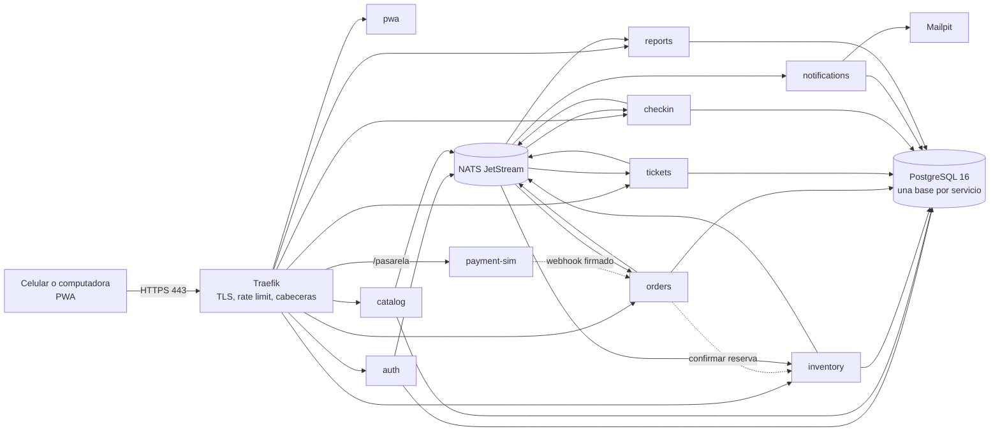
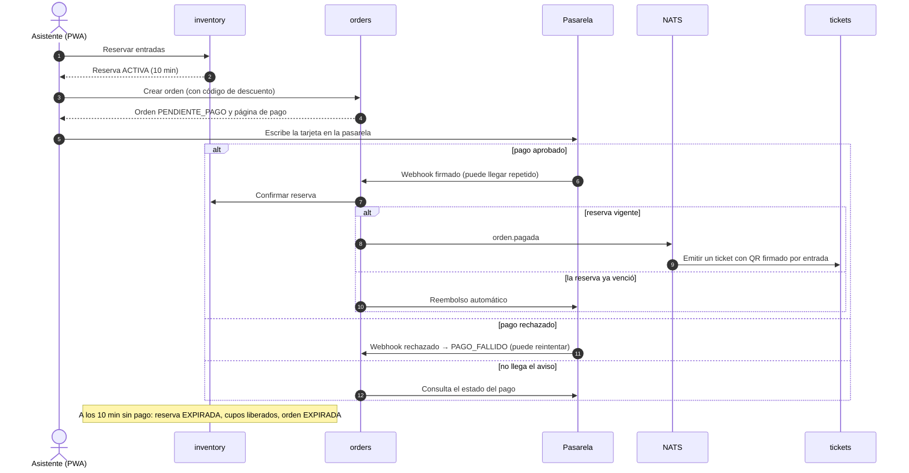

# Arquitectura

Plataforma web (PWA) de gestión de eventos construida con **microservicios** independientes, cada uno con su propia base de datos, coordinados por eventos de dominio y desplegados con Docker en un solo servidor EC2 de AWS.

Recorrido principal:

```
publicar evento → buscar → reservar 10 min sin sobreventa → pagar (pasarela de pruebas)
→ ticket con QR firmado → validar ingreso (también sin conexión) → panel del organizador
```

---

## 1. Stack tecnológico

| Capa | Tecnología | Versión | Uso en el proyecto |
|---|---|---|---|
| Lenguaje y entorno | JavaScript (ESM) sobre **Node.js** | 22 LTS | Todos los servicios y las herramientas del repositorio |
| Framework de servicios | **Fastify** | 5 | API HTTP de cada servicio; valida cada ruta con JSON Schema y genera su OpenAPI (`/docs`) |
| Base de datos | **PostgreSQL** | 16 | Una base y un usuario por servicio; transacciones y descuento atómico de cupos |
| Mensajería | **NATS JetStream** | 2.10 | Eventos de dominio entre servicios, con persistencia y descarte de duplicados |
| Autenticación | **JWT** (librería `jose`), **bcrypt** | — | Token de acceso EdDSA de 15 min y renovación rotativa en cookie HttpOnly |
| Firma de tickets | **Ed25519** (`node:crypto`, WebCrypto en el navegador) | — | QR firmado que se verifica incluso sin conexión |
| Interfaz | **React** + **Vite** + **vite-plugin-pwa** | 18 / 6 | PWA instalable con Service Worker, responsive para celular y escritorio |
| Almacenamiento local | **IndexedDB** (`idb-keyval`) | — | Tickets y lista de validación disponibles en modo avión |
| QR | `qrcode` (generar) y `@zxing/browser` (leer con la cámara) | — | Ticket y control de acceso |
| Gateway | **Traefik** | 3.3 | HTTPS con Let's Encrypt, límite de peticiones y cabeceras de seguridad |
| Correo de pruebas | **Mailpit** + `nodemailer` | — | Comprobantes y avisos sin enviar correos reales |
| Contenedores | **Docker** y **Docker Compose** | — | Toda la plataforma se levanta con un comando |
| Infraestructura | **AWS EC2** (c7i-flex.large, Ubuntu 24.04) | — | Un solo servidor, sin servicios gestionados |
| CI/CD | **GitHub Actions**, **Trivy**, **gitleaks** | — | Lint, pruebas, imágenes, escaneo de vulnerabilidades y de secretos |
| Pruebas | **Vitest** y pruebas de integración en Node | — | Unitarias, concurrencia y flujo completo |

---

## 2. Microservicios

| Servicio | Responsabilidad | Base de datos | Publica | Consume |
|---|---|---|---|---|
| `auth` | Registro, inicio de sesión, bloqueo por intentos fallidos, sesiones y roles | auth | `usuario.registrado` | — |
| `catalog` | Eventos, tipos de entrada, códigos de descuento y búsqueda | catalog | `evento.publicado`, `evento.cancelado` | `orden.pagada` |
| `inventory` | Cupos, reservas temporales de 10 min y liberación automática | inventory | `reserva.expirada` | `evento.publicado`, `evento.cancelado` |
| `orders` | Órdenes, cobro con la pasarela, webhook idempotente y reembolsos | orders | `orden.pagada`, `orden.fallida`, `orden.reembolsada` | `reserva.expirada`, `evento.cancelado` |
| `payment-sim` | Pasarela de pagos en modo de pruebas (actor externo) | — | webhook firmado a `orders` | — |
| `tickets` | Emisión de tickets con QR firmado, consulta e invalidación | tickets | `ticket.emitido`, `ticket.invalidado` | `orden.pagada`, `orden.reembolsada`, `evento.cancelado`, `ingreso.registrado` |
| `checkin` | Validación del QR, ingreso único, lista sin conexión y sincronización | checkin | `ingreso.registrado` | `ticket.emitido`, `ticket.invalidado` |
| `notifications` | Correos de bienvenida, comprobante y reembolso | notifications | — | `usuario.registrado`, `orden.pagada`, `orden.reembolsada` |
| `reports` | Ventas, recaudado, aforo e ingresos para el panel; exportación CSV | reports | — | `evento.publicado`, `orden.pagada`, `orden.reembolsada`, `ingreso.registrado` |
| `pwa` | Interfaz del asistente, organizador, personal de acceso y administración | IndexedDB local | — | — |

Código compartido en `packages/common`: servidor HTTP, conexión a la base, outbox, consumidor idempotente, verificación de JWT y firmas.

---

## 3. Vista de despliegue



Todo corre con Docker Compose en una instancia EC2. Solo Traefik publica los puertos 80 y 443; el 80 redirige al dominio con HTTPS. Postgres, NATS y Mailpit no se exponen. El acceso de administración es por SSH a través de un EC2 Instance Connect Endpoint, sin el puerto 22 abierto a internet (ver `docs/operacion.md`).

---

## 4. Estructura del repositorio

```
plataforma-gestion-eventos/
├── apps/pwa/                 PWA: React + Vite + vite-plugin-pwa
│   └── src/pantallas/        Login, Catálogo, Detalle, Pago, Orden, Tickets, Panel, NuevoEvento, Acceso, Cuenta
├── services/                 un microservicio por carpeta (src/index.js)
│   ├── auth/  catalog/  inventory/  orders/  payment-sim/
│   └── tickets/  checkin/  notifications/  reports/
├── packages/common/          utilidades compartidas y sus pruebas unitarias
├── infra/
│   ├── Dockerfile.servicio   imagen común de los servicios (usuario sin privilegios)
│   ├── traefik/              rutas, límites de peticiones y cabeceras
│   ├── postgres/init.sh      una base y un usuario por servicio
│   └── deploy/               creación del EC2 y despliegue
├── tests/                    concurrencia (200 usuarios, cupo 50) y flujo completo
├── scripts/generar-env.mjs   genera .env con contraseñas y claves aleatorias
├── docs/                     arquitectura, operación, usuarios y pantallas, procesos BPMN, entregables
├── compose.yaml              levanta toda la plataforma
└── .github/workflows/ci.yml  pipeline de CI/CD
```

---

## 5. API principal

Prefijo público: `https://<dominio>/api/<servicio>`. Las rutas `/internal/*` solo se usan dentro de la red de Docker y Traefik las bloquea desde afuera (403). Cada servicio publica su OpenAPI en `/docs`.

| Servicio | Rutas principales | Requisitos |
|---|---|---|
| auth | `POST /register` · `POST /login` · `POST /refresh` · `POST /logout` · `GET /me` · `PATCH /users/:id/role` (admin) · CRUD `/personas` (admin, [Laboratorio 01](laboratorio-01.md)) | RF01, RF03 |
| catalog | `GET /events` (filtros) · `GET /events/:id` · `GET /mine` · `POST /events` · `POST /events/:id/publish` · `POST /events/:id/cancel` · `POST /events/:id/discounts` | RF04-RF06, RF13 |
| inventory | `GET /availability/:id` · `POST /reservations` · `GET /reservations/:id` | RF07-RF10 |
| orders | `POST /orders` · `GET /orders/:id` · `POST /orders/:id/retry` · `POST /webhooks/payment` | RF12, RF14, RF15 |
| tickets | `GET /me/tickets` · `GET /tickets/:id` | RF17, RF18, RF20 |
| checkin | `POST /validate` · `GET /events/:id/offline-package` · `POST /sync` · `GET /events/:id/summary` | RF21-RF23 |
| reports | `GET /events/:id/dashboard` · `GET /events/:id/export.csv` | RF25, RF26 |

**Reserva sin sobreventa (RN02):** el cupo se comprueba y se descuenta en la misma sentencia (`UPDATE cupos SET disponible = disponible - n WHERE ... AND disponible >= n`), dentro de una función de PostgreSQL que crea la reserva en un solo viaje a la base. Con compras simultáneas solo pasa quien alcanza cupo. Un proceso cada 15 s vence las reservas no pagadas y devuelve sus cupos (RN01).

---

## 6. Eventos de dominio y garantías

Cada evento viaja con el sobre `{ id, tipo, version, ocurridoEn, datos }` en el subject `dominio.<tipo>` de NATS JetStream.

- **Outbox:** el servicio guarda el evento en su tabla `outbox` en la misma transacción que el cambio de estado, y un relay lo publica. Nada se pierde si el broker no está disponible un momento.
- **Sin duplicados:** JetStream descarta un mismo `id` repetido, y cada consumidor registra el `id` en `mensajes_procesados` en la misma transacción que aplica el efecto. Un evento repetido no duplica tickets, correos ni ventas (RNF14).
- **Servicios secundarios:** si `notifications` o `reports` caen, la compra sigue y se ponen al día al volver (RNF04).

---

## 7. Saga de compra



Estados de la orden (RN11): `PENDIENTE_PAGO` → `PAGADA` / `PAGO_FALLIDO` / `EXPIRADA` → `REEMBOLSADA`. Estados de la reserva (RN12): `ACTIVA` → `CONFIRMADA` / `EXPIRADA`.

Cancelar un evento (CU15) invalida todos sus tickets, reembolsa cada orden pagada y avisa por correo a los asistentes (RN07).

---

## 8. QR firmado y modo sin conexión

- El QR contiene `{tid, eid, tipo, iat}` firmado con Ed25519. Solo `tickets` tiene la clave privada (RN04).
- **En línea:** `checkin` verifica la firma y el evento, revisa el estado del ticket y registra el ingreso una sola vez. El segundo escaneo responde "ya usado" con la hora del primero (RN05).
- **Sin conexión:** el personal de acceso descarga antes la lista del evento con la clave pública. Sin internet, la PWA verifica la firma con WebCrypto, revisa la lista guardada y deja el ingreso pendiente. Al volver la conexión sincroniza y se informan los duplicados entre lectores (RF23, R10).
- El asistente ve sus tickets en modo avión porque quedan guardados en el teléfono (RF18).

---

## 9. Seguridad (OWASP Top 10:2025)

| ID | Vulnerabilidad | OWASP 2025 | Control implementado |
|---|---|---|---|
| V1 | Control de acceso roto (ver datos ajenos) | A01 Broken Access Control | Cada orden, reserva y ticket se busca por id **y** dueño; si no es suyo responde 404. Roles en cada ruta |
| V2 | Autenticación débil | A07 Authentication Failures | Bloqueo de 15 min tras 3 intentos fallidos, contraseña como hash bcrypt, sesión de 15 min y renovación rotativa que detecta reutilización |
| V3 | Tickets falsificables o reutilizables | A08 Software or Data Integrity Failures | QR firmado con Ed25519, estado del ticket e ingreso único |
| V4 | Condición de carrera en los cupos | A06 Insecure Design | Descuento atómico en la base; prueba con 200 usuarios contra 50 cupos |
| V5 | Inyección y XSS | A05 Injection | JSON Schema en cada ruta (descarta campos no declarados), consultas parametrizadas, CSP estricta |
| V6 | Confianza implícita entre servicios | A02 Security Misconfiguration | Rutas internas con token de servicio de 60 s y bloqueadas en Traefik; un usuario de base de datos por servicio |
| V7 | Secretos expuestos | A02 Security Misconfiguration · A04 Cryptographic Failures | Secretos solo en `.env` (no versionado), generados al azar; gitleaks en cada push |
| V8 | Dependencias e imágenes vulnerables | A03 Software Supply Chain Failures | `npm audit` y Trivy en cada build; acciones de CI fijadas por SHA |

Controles adicionales:
- **Transporte:** HTTPS con HSTS y cabeceras `X-Content-Type-Options`, `Referrer-Policy` y `frame-ancestors 'none'`.
- **Límite de peticiones:** 5 por minuto en login y registro, y 20 por minuto en reservas.
- **Contenedores:** corren sin root, con sistema de archivos de solo lectura y sin capacidades.
- **Logs:** se escriben en JSON sin contraseñas, tokens ni correos, y las acciones críticas quedan marcadas (RN10).
- **LOPDP:** no se guardan datos de tarjeta y se piden solo el nombre y el correo.

---

## 10. Pruebas y CI/CD

| Prueba | Qué demuestra |
|---|---|
| Unitarias (Vitest) | Firma y verificación del QR; firma del webhook |
| Concurrencia | 200 usuarios reservan a la vez sobre un cupo de 50: exactamente 50 reservas, cero sobreventa, sin errores 5xx (RNF01-RNF03) |
| Flujo completo | Reserva, descuento, pago con aviso repetido sin duplicar tickets, sin IDOR, ingreso único, QR alterado rechazado, sincronización con duplicados, panel, bloqueo de cuenta, rutas internas protegidas, correo único, cancelación con reembolso |

Pipeline (`.github/workflows/ci.yml`), en cada push:
1. Lint, pruebas unitarias y `npm audit`.
2. Escaneo de secretos con gitleaks.
3. Construcción de cada imagen y escaneo con Trivy, que falla con vulnerabilidades críticas.
4. Pruebas de concurrencia y de flujo completo con Docker Compose.
5. Job de despliegue al EC2, preparado.
