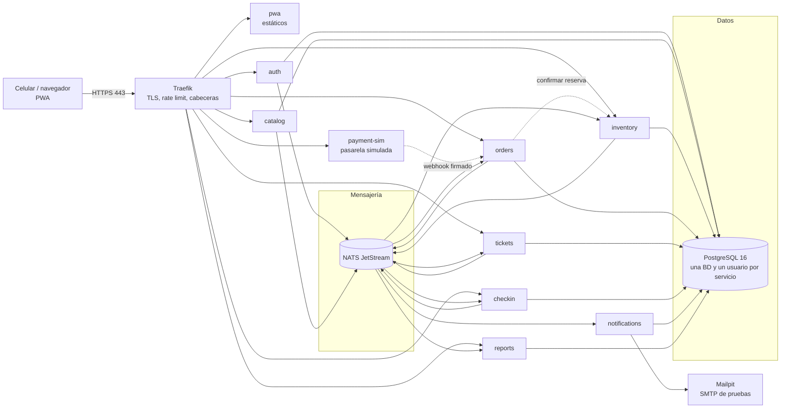
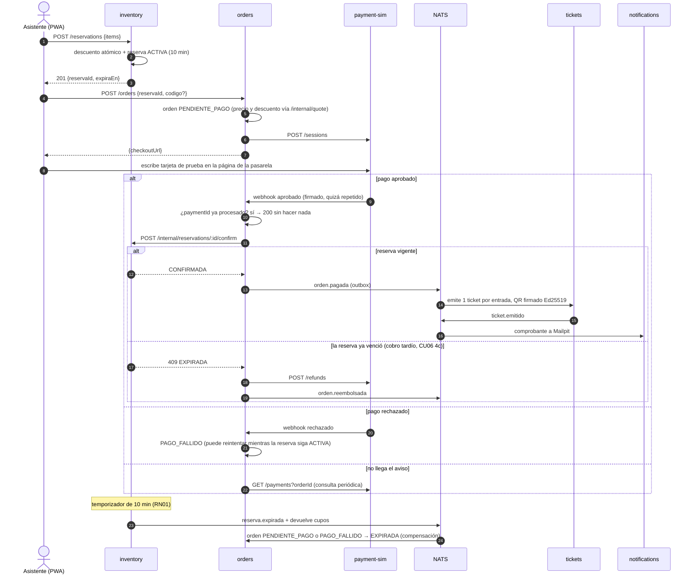
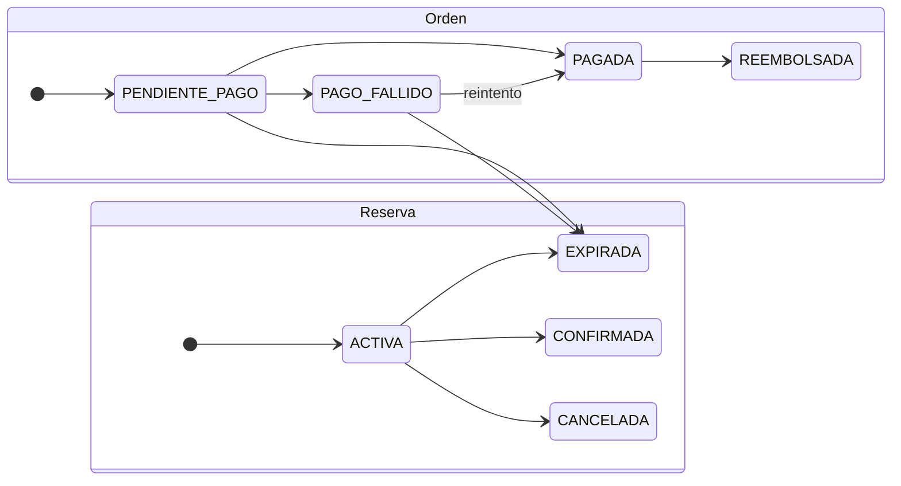

# Arquitectura del primer prototipo

> Estado: **propuesta, pendiente de confirmación** (paso 1 de la sección 14 de `docs/base-conocimiento.md`).
> Hasta que se confirme no se escribe código. Los IDs (RF, RNF, CU, RN, R, V) remiten a la base de conocimiento.

Recorrido que debe funcionar de punta a punta:

```
publicar evento → buscar → reservar 10 min sin sobreventa → pagar (pasarela simulada)
→ ticket con QR firmado → validar ingreso (también sin conexión) → panel del organizador
```

---

## 1. Decisiones que necesito que confirmes

Cada una trae mi recomendación. Si no dices nada, uso la recomendada.

| # | Tema | Recomendación | Por qué |
|---|---|---|---|
| D1 | Broker de mensajes | **NATS con JetStream** | Un solo binario liviano para el EC2; JetStream da persistencia, consumidores durables y descarte de duplicados por `Nats-Msg-Id` (RNF14) |
| D2 | Proxy inverso | **Traefik v3** (no Caddy) | Trae límite de peticiones y cabeceras de seguridad incluidos. Caddy necesita compilar un plugin para el rate limit |
| D3 | Versión de Node | **Node 22 LTS** (no Node 20) | Node 20 dejó de tener soporte en abril de 2026 y Trivy lo marcaría. Node 22 tiene soporte hasta abril de 2027, más allá del cierre del proyecto, y es la versión instalada en tu equipo |
| D4 | Intentos fallidos antes del bloqueo | **3** (decidido) | Coincide con el BPMN `01-registro-y-autenticacion` y el documento de procesos. Es configurable con `MAX_INTENTOS` |
| D5 | Confirmación de la reserva al pagar | **Comando síncrono** `orders → inventory` (idempotente) | La reserva tiene que confirmarse antes de emitir tickets. Una llamada interna atómica evita la carrera con el job de expiración sin inventar estados nuevos en RN11. Todo lo demás de la saga (tickets, correos, reportes) va por eventos. Es la única excepción al principio de "síncrono solo para consultas" |
| D6 | Nombres de servicios | Usar los de la base (`auth`, `catalog`, `inventory`…) y dejar la equivalencia con los `ms-*` del documento de Bizagi (tabla en la sección 9) | Así el código sigue la arquitectura de referencia y el documento entregado sigue siendo válido |
| D7 | Pasarela simulada | Contenedor propio `payment-sim` que hace el papel del pool externo "Pasarela de pago" | La tarjeta se escribe en la página de la pasarela, no en la PWA: los datos de tarjeta nunca pasan por nuestros servicios (RN09) |
| D8 | Gestor del monorepo | **npm workspaces** | Viene con Node, sin herramientas extra |

---

## 2. Vista de despliegue



Todo corre con Docker Compose en una sola máquina (local o el EC2). Solo Traefik publica puertos (443, y 80 que redirige a 443). Mailpit expone su interfaz en `localhost:8025` solo en desarrollo.

---

## 3. Árbol de carpetas

```
plataforma-gestion-eventos/
├── apps/
│   └── pwa/                      React + Vite + TS + vite-plugin-pwa
│       └── src/
│           ├── pages/            Login, Catalogo, DetalleEvento, ReservaPago,
│           │                     MisTickets, PanelOrganizador, NuevoEvento, Acceso
│           ├── offline/          IndexedDB (idb): tickets y paquete de validación
│           ├── qr/               generación (qrcode) y lectura (@zxing/browser)
│           └── api/              cliente HTTP con refresh de token
├── services/
│   ├── auth/                     cada servicio tiene la misma forma:
│   ├── catalog/                    src/routes, src/domain, src/db (migraciones SQL),
│   ├── inventory/                  src/events (publicadores y consumidores),
│   ├── orders/                     test/, Dockerfile, openapi en /docs
│   ├── tickets/
│   ├── checkin/
│   ├── notifications/
│   ├── reports/
│   └── payment-sim/              pasarela simulada (actor externo)
├── packages/
│   └── common/                   logger con redacción, verificación de JWT,
│                                 outbox, consumidor idempotente, config con Zod
├── infra/
│   ├── docker-compose.yml
│   ├── docker-compose.observability.yml   Prometheus + Grafana (opcional)
│   ├── traefik/                  rutas, middlewares (rate limit, cabeceras)
│   ├── postgres/init.sql         crea una BD y un usuario por servicio
│   └── deploy/                   guía y script para el EC2
├── tests/
│   ├── concurrencia/             200 usuarios contra un cupo de 50
│   └── e2e/                      flujo de compra completo y webhook repetido
├── docs/
│   ├── base-conocimiento.md
│   ├── arquitectura.md           este archivo
│   ├── decisiones.md             ADR cortos
│   ├── procesos/                 BPMN y modelos de Bizagi
│   └── entregables/              PDF de los talleres y tareas
├── .github/workflows/ci.yml
├── .env.example
├── Makefile                      make up / make test / make concurrencia
└── README.md
```

---

## 4. Contratos de API principales

Prefijo público: `https://localhost/api/<servicio>`. Rutas `/internal/*`: solo dentro de la red de Docker, con token de servicio. Traefik no las enruta.

### auth (RF01, RF02, RF03, RNF05)

| Método y ruta | Rol | Qué hace |
|---|---|---|
| `POST /register` | público | Crea un ASISTENTE u ORGANIZADOR. Contraseña ≥ 10 caracteres, hash con argon2id |
| `POST /login` | público | Devuelve `accessToken` (15 min) y deja el refresh token en una cookie `HttpOnly; Secure; SameSite=Strict`. Tras 3 fallos bloquea 15 min. Rate limit en Traefik |
| `POST /refresh` · `POST /logout` | sesión | Rota el refresh token o lo revoca |
| `GET /me` | sesión | Perfil y rol |
| `PATCH /users/:id/role` | ADMIN | Cambia el rol y lo registra en el log de acciones críticas (RN10) |
| `GET /.well-known/jwks.json` | interno | Clave pública Ed25519 para que cada servicio verifique los JWT |

### catalog (RF04, RF05, RF06, RF13)

| Método y ruta | Rol | Qué hace |
|---|---|---|
| `GET /events?q&categoria&ciudad&desde&hasta&precioMax` | público | Busca eventos PUBLICADOS. Consultas parametrizadas |
| `GET /events/:id` | público | Detalle con tipos de entrada |
| `POST /events` · `PATCH /events/:id` | ORGANIZADOR (dueño) | Crea o edita un BORRADOR |
| `POST /events/:id/ticket-types` | ORGANIZADOR (dueño) | Tipo de entrada: nombre, precio, cupo, inicio y fin de venta |
| `POST /events/:id/publish` | ORGANIZADOR (dueño) | BORRADOR → PUBLICADO; publica `evento.publicado` |
| `POST /events/:id/cancel` | ORGANIZADOR (dueño) | → CANCELADO; publica `evento.cancelado` (RN07) |
| `POST /events/:id/discounts` | ORGANIZADOR (dueño) | Código con porcentaje o monto, vigencia y límite de usos (RN08) |
| `GET /internal/quote` | servicio | Precios y descuento validado para armar una orden |

### inventory (RF07 a RF10, RN01 a RN03, RN12)

| Método y ruta | Rol | Qué hace |
|---|---|---|
| `GET /availability/:eventId` | público | Cupos disponibles por tipo |
| `POST /reservations` | ASISTENTE | `{eventId, items:[{ticketTypeId, cantidad}]}`. Descuento atómico (abajo), reserva ACTIVA que vence en 10 min. `409` si no alcanza, con lo disponible |
| `GET /reservations/:id` | ASISTENTE (dueño) | Estado y `expiraEn` para la cuenta regresiva |
| `POST /internal/reservations/:id/confirm` | servicio (orders) | ACTIVA → CONFIRMADA solo si no venció. Idempotente |

Descuento atómico, uno por ítem y todos en la misma transacción:

```sql
UPDATE cupos SET disponible = disponible - $2
 WHERE tipo_entrada_id = $1 AND disponible >= $2
RETURNING disponible;   -- 0 filas => no alcanza => ROLLBACK
```

Job de expiración cada 15 s: `UPDATE reservas SET estado='EXPIRADA' WHERE estado='ACTIVA' AND expira_en < now() RETURNING ...`, devuelve los cupos y escribe `reserva.expirada` en el outbox, todo en una transacción. La confirmación usa `WHERE estado='ACTIVA' AND expira_en > now()`, así que el job y la confirmación nunca ganan los dos sobre la misma reserva.

### orders (RF12, RF14, RF15, RNF14, RN06, RN09, RN11)

| Método y ruta | Rol | Qué hace |
|---|---|---|
| `POST /orders` | ASISTENTE | `{reservationId, codigoDescuento?, nombre, correo, aceptaTerminos}` → orden PENDIENTE_PAGO y `checkoutUrl` de la pasarela |
| `GET /orders/:id` | ASISTENTE (dueño) | Estado y comprobante. Otro usuario recibe `404` (sin IDOR, V1) |
| `POST /orders/:id/retry` | ASISTENTE (dueño) | Nuevo intento si está en PAGO_FALLIDO y la reserva sigue vigente |
| `POST /webhooks/payment` | pasarela | Firma HMAC en la cabecera `X-Firma`. Idempotente por `paymentId` (tabla `pagos` con clave única) |

### payment-sim (actor externo simulado)

| Método y ruta | Qué hace |
|---|---|
| `POST /sessions` | orders crea la sesión de cobro `{orderId, monto, returnUrl, webhookUrl}` |
| `GET /checkout/:sessionId` | Página de pago propia, donde se escribe la tarjeta de prueba |
| `GET /payments?orderId=` | Consulta de estado cuando no llega el aviso (CU06 4b) |
| `POST /refunds` | Reembolso total o parcial |

Tarjetas de prueba: `4242 4242 4242 4242` aprueba · `4000 0000 0000 0002` rechaza · `4000 0000 0000 9995` no envía webhook (obliga a consultar) · `4000 0000 0000 0259` aprueba y envía el webhook **dos veces** (demo de idempotencia).

### tickets (RF17, RF18, RF20, RN04)

| Método y ruta | Rol | Qué hace |
|---|---|---|
| `GET /me/tickets` | ASISTENTE | Mis tickets con el QR ya firmado, para guardarlos en IndexedDB |
| `GET /tickets/:id` | ASISTENTE (dueño) | Detalle. Otro usuario recibe `404` |
| `POST /tickets/:id/transfer` | — | `501 Próximamente` (RF19 fuera de alcance) |

### checkin (RF21 a RF23, RN05, R10)

| Método y ruta | Rol | Qué hace |
|---|---|---|
| `POST /validate` | ACCESO | `{qr, eventId}` → `VALIDO` (registra el ingreso), `USADO` (con hora del primer ingreso) o `INVALIDO` (con motivo) |
| `GET /events/:id/offline-package` | ACCESO | `{clavePublica, tickets:[{tid, tipo, titular, estado}], generadoEn}` |
| `POST /sync` | ACCESO | `{dispositivoId, registros:[{tid, escaneadoEn}]}` → por registro: `aceptado`, `duplicado` (con hora del primero) o `invalido` |
| `GET /events/:id/summary` | ACCESO, ORGANIZADOR | Contador de ingresos (CU25) |

Ingreso único: `INSERT INTO ingresos (tid, ...) ON CONFLICT (tid) DO NOTHING RETURNING *`. Si no devuelve fila, ya había entrado y se responde `USADO` con la hora guardada.

### reports (RF25, RF26)

| Método y ruta | Rol | Qué hace |
|---|---|---|
| `GET /events/:id/dashboard` | ORGANIZADOR (dueño) | Vendidas, recaudado, % de aforo, barras por tipo, ingresos |
| `GET /events/:id/export.csv` | ORGANIZADOR (dueño) | Exportación CSV |

Cada servicio expone `GET /health` y su OpenAPI en `/docs` (fastify-swagger).

---

## 5. Catálogo de eventos de dominio

Subjects de NATS con el formato `<contexto>.<hecho>`. Sobre común:

```json
{ "id": "uuid (también va en Nats-Msg-Id)", "tipo": "orden.pagada", "version": 1,
  "ocurridoEn": "2026-11-20T15:04:05Z", "datos": { } }
```

| Evento | Productor | Consumidores | Datos principales |
|---|---|---|---|
| `usuario.registrado` | auth | notifications | `usuarioId, nombre, correo` |
| `evento.publicado` | catalog | inventory (crea cupos), reports | `eventoId, organizadorId, titulo, fecha, tiposEntrada:[{id, nombre, precio, cupo}]` |
| `evento.cancelado` | catalog | orders (reembolsa), tickets (invalida), notifications | `eventoId, motivo` |
| `reserva.creada` | inventory | reports (opcional) | `reservaId, usuarioId, items, expiraEn` |
| `reserva.expirada` | inventory | orders (orden → EXPIRADA) | `reservaId` |
| `reserva.confirmada` | inventory | reports | `reservaId, ordenId` |
| `orden.pagada` | orders | tickets (emite), notifications (comprobante), reports, catalog (cuenta usos del descuento) | `ordenId, usuarioId, eventoId, items, total, correo, nombre` |
| `orden.fallida` | orders | notifications | `ordenId, motivo` |
| `orden.reembolsada` | orders | tickets (invalida), reports, notifications | `ordenId, monto, motivo` |
| `ticket.emitido` | tickets | checkin (lista de validación) | `tid, eventoId, tipo, titular` |
| `ticket.invalidado` | tickets | checkin | `tid, eventoId, motivo` |
| `ingreso.registrado` | checkin | reports | `tid, eventoId, ingresoEn, origen: en_linea / sincronizado` |

Garantías:

- **Outbox:** cada servicio escribe el evento en su tabla `outbox` en la misma transacción que el cambio de estado. Un relay lo publica en JetStream con `Nats-Msg-Id = id`, que descarta duplicados dentro de la ventana.
- **Consumidor idempotente:** cada consumidor guarda el `id` en `mensajes_procesados` dentro de la transacción que aplica el efecto. Si el mensaje se repite, no hace nada (RNF14).
- **Datos personales mínimos** en los eventos: solo nombre y correo donde hacen falta (comprobante y titular del ticket).

---

## 6. Saga de compra



Estados (RN11, RN12):



Cancelar un evento (P4, CU15, CU16): `evento.cancelado` → tickets invalida todos los del evento (`ticket.invalidado` → checkin los rechaza) y orders reembolsa cada orden PAGADA (`orden.reembolsada`) → notifications avisa a cada asistente.

---

## 7. QR firmado y validación sin conexión

- **Contenido del QR:** `base64url(payload) + "." + base64url(firma)`, con `payload = {tid, eid, tipo, iat}` (RN04). Firma Ed25519 con la clave privada que solo tiene `tickets` (variable de entorno).
- **En línea:** checkin verifica la firma, comprueba que `eid` es el evento que se está controlando, revisa el estado en su proyección y registra el ingreso único.
- **Sin conexión (RF23, RNF09):** antes del evento, la pantalla de acceso descarga el paquete del evento a IndexedDB. Sin internet verifica la firma en el navegador con `@noble/ed25519` y la clave pública del paquete, revisa el estado contra la lista local, marca el ticket como usado en local y encola el registro. Al volver la conexión envía la cola a `POST /sync` y muestra los duplicados que haya detectado el servidor (R10).
- **Ticket del asistente sin conexión (RF18):** "Mis tickets" guarda los QR en IndexedDB y el Service Worker cachea la aplicación. El ticket se ve en modo avión.

---

## 8. Seguridad mínima (sección 11)

| Control | Cómo | Vulnerabilidad |
|---|---|---|
| Sin IDOR | Toda consulta de órdenes y tickets filtra por `usuario_id = sub del JWT`; si no es suyo devuelve `404`. Pruebas automáticas lo verifican | V1 |
| Sesiones | JWT EdDSA de 15 min, refresh rotativo en cookie HttpOnly, bloqueo tras 3 fallos, rate limit en `/login` | V2 |
| Tickets | QR firmado + estado + ingreso único | V3 |
| Concurrencia | Descuento atómico + prueba con 200 usuarios | V4 |
| Entradas | Zod en cada ruta, SQL parametrizado, React escapa por defecto, CSP sin `unsafe-inline` | V5 |
| Entre servicios | Las rutas `/internal/*` exigen un JWT de servicio (`aud=internal`, `sub=<servicio>`, 60 s de vida) firmado con un secreto propio de cada servicio. Traefik no las expone. Cada servicio usa un usuario de BD con permisos solo sobre su base | V6 |
| Secretos | Solo en `.env` (no versionado) con `.env.example` sin valores reales; gitleaks en CI | V7 |
| Dependencias | `npm audit` y Trivy (falla con CRITICAL) en cada build | V8 |
| Logs | pino en JSON con `redact` de `password`, `authorization`, `cookie`, `token`, `qr` y correo enmascarado | Política 9 |
| Cabeceras | En Traefik: HSTS, CSP, `X-Content-Type-Options: nosniff`, `Referrer-Policy`, `frame-ancestors 'none'` | Política 3 |
| Rate limit | Traefik: `/api/auth/login` 5/min por IP, `/api/inventory/reservations` 20/min por IP | R4 |

---

## 9. Diferencias con los BPMN y el documento de Bizagi

Comparé `docs/procesos/*.bpmn` y `docs/entregables/03-tarea-1.1-procesos-e-involucrados.pdf` con la base de conocimiento:

| Tema | BPMN / documento de procesos | Base de conocimiento | Qué propongo |
|---|---|---|---|
| Intentos antes del bloqueo | 3 | 5 | D4: se unifica en 3, como el BPMN |
| Servicios | `ms-usuarios` y `ms-autenticacion` separados; `ms-eventos` y `ms-catalogo` separados; no hay servicio de reportes | `auth` y `catalog` unificados; existe `reports` | D6: equivalencia `ms-usuarios`/`ms-autenticacion` → `auth`, `ms-eventos`/`ms-catalogo` → `catalog`, `ms-reservas` → `inventory`, `ms-pagos` → `orders`, `ms-tickets` → `tickets`, `ms-notificaciones` → `notifications`, `ms-acceso` → `checkin` |
| Roles | `ms-usuarios`: asistente u organizador | 4 roles (más ACCESO y ADMIN) | Se implementan los 4; el BPMN no los contradice, solo no los modela |
| Publicar evento | Sin moderación del administrador; con vista previa y opción de guardar borrador | P1 incluye moderación | Prototipo como el BPMN (moderación fuera de alcance, según la sección 14) |
| Cancelación | `04`: **el asistente** cancela su entrada con política de 48 h y aprobación del organizador | P4 / CU15: **el organizador** cancela el evento completo | Prototipo: solo P4. La cancelación por el asistente no tiene RF propio; propongo añadirla a la segunda etapa o crear un RF nuevo |
| Expiración de la reserva | Temporizador de borde PT10M | RN01, 10 min | Coinciden |
| Check-in sin conexión | `05` no modela el modo sin conexión | P3 sí (gateway "¿hay conexión?") | Conviene agregar ese gateway al BPMN 05 para la presentación |

Otros detalles que vi al revisar la carpeta:

- La carátula de `Documento-procesos-gestion-eventos.pdf` (y del `.docx`) todavía tiene los marcadores `[Nombre de la asignatura]`, `[Nombre del docente]` e `[Integrante 1]` a `[Integrante 4]`.
- Los PDF del Taller 1.1 y del Taller 1.2 tienen fecha de **2025** en la carátula; las actividades son de 2026.
- No está en la carpeta el PDF de la Tarea 1.2 (Plan de construcción) ni el de la Propuesta del SI. Su contenido sí está en la base de conocimiento (secciones 2, 3, 5, 6, 7, 11, 12 y 13).

---

## 10. Pruebas clave

| Prueba | Qué demuestra | Criterio |
|---|---|---|
| `tests/concurrencia` | 200 usuarios distintos reservan 1 entrada a la vez sobre un tipo con cupo 50, directo contra inventory (sin el rate limit de Traefik) | Exactamente 50 respuestas `201`, 150 `409`, `disponible = 0`, 50 reservas ACTIVA (RNF03, OE1) |
| `tests/e2e/webhook-repetido` | El mismo webhook aprobado se envía 5 veces | 1 orden PAGADA, N tickets (uno por entrada), 1 correo (RNF14) |
| `tests/e2e/compra` | Recorrido completo de la API | Ticket emitido y validado; el segundo escaneo responde `USADO` |
| Unitarias (Vitest) | Dominio de cada servicio: estados, descuentos, firma y verificación del QR, sin IDOR | Cobertura objetivo ≥ 70 % (RNF12) |
| Expiración | Una reserva sin pago vuelve los cupos | Cupos restaurados y orden EXPIRADA |

CI (`.github/workflows/ci.yml`): lint y typecheck → unitarias con Postgres como servicio → build de imágenes → Trivy (falla con CRITICAL) → gitleaks → e2e con compose (concurrencia y webhook repetido) → job de despliegue por SSH al EC2 preparado pero deshabilitado (`workflow_dispatch` y secretos sin configurar).

---

## 11. Orden de construcción

1. Infraestructura base (compose, Traefik, Postgres, NATS, Mailpit, `packages/common`) + `auth`
2. `catalog` con datos semilla (3 eventos: Quito, Sangolquí, Guayaquil; uno casi agotado y otro agotado; código `ESPE10`)
3. `inventory` + prueba de concurrencia
4. `orders` + `payment-sim`
5. `tickets`
6. `checkin` + modo sin conexión
7. `notifications`
8. `reports`
9. Pantallas de la PWA (las 6 de la sección 13 + login + crear evento)
10. CI

Al cerrar cada incremento: levantar con compose, correr las pruebas y anotar qué RF y CU quedaron cubiertos.
