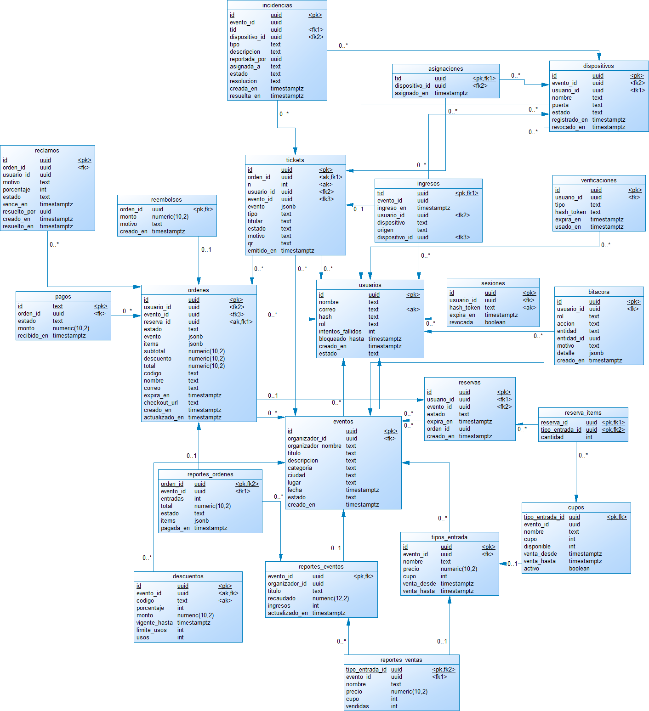
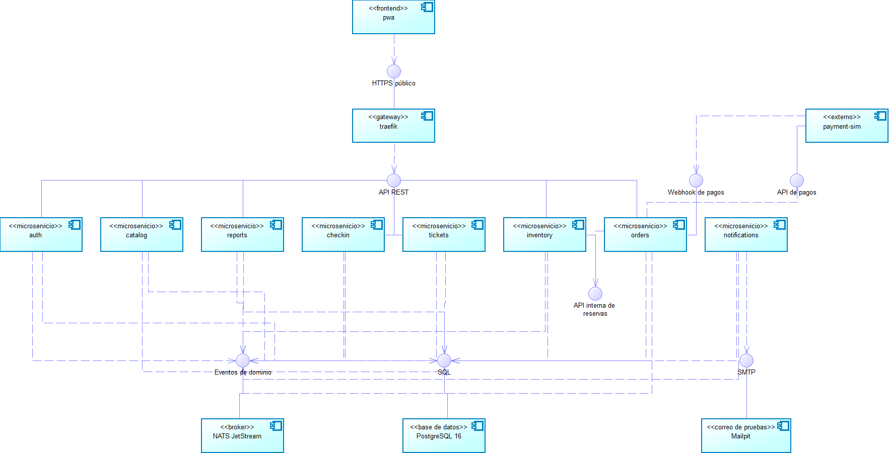

# Diccionario de datos y guía de lectura del modelo ER general

**Proyecto:** Aforo · Plataforma de gestión de eventos  
**Modelo físico:** `ER-general.pdm` (PowerDesigner, PostgreSQL 16)  
**Diagrama:** `img/ER_general.png` y `img/ER_general.emf`  
**Documento:** guía de lectura + diccionario de datos

## Contenido

1. Alcance, servicios y convenciones
2. Cómo se lee el diagrama (recorrido completo)
3. Catálogo de relaciones y cardinalidades
4. Diccionario de datos
5. Diagramas complementarios (componentes, objetos y estados)
6. Buenas prácticas aplicadas

## 1. Alcance, servicios y convenciones

El modelo reúne las entidades de negocio de los servicios `auth`, `catalog`, `inventory`, `orders`, `tickets`, `checkin` y `reports`. La arquitectura es de microservicios: **cada servicio tiene su propia base de datos**, por eso el diagrama distingue entre relaciones **físicas** (misma base, FK real) y **lógicas** (entre servicios, mediante identificadores copiados y validadas por API o eventos).

### 1.1 Servicios y tablas

| Servicio | Tablas del ER general |
|---|---|
| `auth` | `usuarios`, `sesiones` |
| `catalog` | `eventos`, `tipos_entrada`, `descuentos` |
| `inventory` | `cupos`, `reservas`, `reserva_items` |
| `orders` | `ordenes`, `pagos`, `reembolsos` |
| `tickets` | `tickets` (con réplica local en `checkin`) |
| `checkin` | `ingresos` |
| `reports` | `reportes_eventos`, `reportes_ventas`, `reportes_ordenes` |
| `común` | `outbox`, `mensajes_procesados` (ver `ER-comun.pdm`; no se repiten aquí) |

### 1.2 Notación

| Símbolo | Significado |
|---|---|
| `PK` / `<pk>` | Clave primaria: identifica de forma única cada fila. |
| `FK` / `<fk>` | Clave foránea: referencia la PK de otra tabla. |
| `AK` / `<ak>` | Clave alternativa o `UNIQUE`: protege un dato natural. |
| `1` | Exactamente uno. |
| `0..1` | Cero o uno. |
| `0..*` | Cero o muchos. |
| `1..*` | Uno o muchos. |

La cardinalidad se lee en el extremo hijo de la relación. El extremo padre es `1` porque todas las FK del modelo son obligatorias (`NOT NULL`). El diagrama muestra además el tipo de dato de cada columna, lo que permite usarlo como modelo físico de referencia.

**Roles y personas.** En el diseño actual `usuarios` representa tanto la cuenta como la persona (nombre y correo). El rol no es una entidad separada: es la columna `usuarios.rol`, validada con `CHECK` sobre `ASISTENTE`, `ORGANIZADOR`, `ACCESO` y `ADMIN`. El nombre del asistente se copia en `tickets.titular` como snapshot del comprobante. Por eso no existen tablas `roles` ni `personas` en el esquema real; agregarlas sería otro diseño (catálogo de roles y separación persona/cuenta) y requeriría cambiar código y migraciones.

## 2. Cómo se lee el diagrama (recorrido completo)

Cada tabla es una entidad y cada fila, una instancia. Las líneas unen una PK con una FK. Para leer una relación se parte del padre y se sigue la cardinalidad del hijo:

- `usuarios 1 ── 0..* sesiones`: un usuario puede tener cero o muchas sesiones; cada sesión pertenece a exactamente un usuario.
- `reservas 1 ── 0..1 ordenes`: una reserva puede generar como máximo una orden; cada orden corresponde a exactamente una reserva (la FK `reserva_id` es `UNIQUE`).
- `tickets 1 ── 0..1 ingresos`: un ticket puede registrarse como ingreso una sola vez; cada ingreso corresponde a exactamente un ticket (la PK de `ingresos` es también FK a `tickets`).
- `reservas 1 ── 0..* reserva_items 0..* ── 1 cupos`: relación muchos-a-muchos resuelta con la tabla asociativa `reserva_items`; una reserva puede incluir varios tipos de entrada y un tipo puede estar en varias reservas.

### 2.1 Recorrido de negocio de extremo a extremo

1. **Cuenta y sesión (`auth`).** Un registro crea un usuario en `usuarios`; al iniciar sesión se crean filas en `sesiones` (0..* por usuario). El rol determina qué puede hacer: `ASISTENTE`, `ORGANIZADOR`, `ACCESO` o `ADMIN`.
2. **Publicación (`catalog`).** Un usuario con rol ORGANIZADOR crea uno o varios eventos en `eventos`. Cada evento define sus `tipos_entrada` (precio y cupo) y, opcionalmente, `descuentos`.
3. **Disponibilidad (`inventory`).** Por cada tipo de entrada se crea un registro en `cupos` con el mismo identificador (relación 1:1 lógica). Un asistente crea una reserva en `reservas` y su detalle en `reserva_items`; el cupo se descuenta de forma atómica para evitar sobreventa (RN02). La reserva vence a los 10 minutos (RN01).
4. **Compra (`orders`).** Una reserva genera como máximo una orden en `ordenes` (`reserva_id` es `UNIQUE`). La orden guarda un snapshot del evento y de los ítems, calcula subtotal, descuento y total, y se paga en la pasarela. Cada intento de pago queda en `pagos` (0..* por orden, con idempotencia); si la orden se cancela o reembolsa, se registra en `reembolsos` (0..1 por orden).
5. **Emisión y acceso (`tickets` y `checkin`).** Una orden pagada emite 0..* `tickets`, uno por asistente, con QR firmado (RN04). En la puerta, `checkin` valida el QR y registra el ingreso en `ingresos`; la PK `tid` garantiza un solo ingreso por ticket (RN05). El personal de acceso queda registrado en `ingresos.usuario_id`.
6. **Panel (`reports`).** `reports` mantiene proyecciones de lectura: `reportes_eventos` (recaudado e ingresos), `reportes_ventas` (vendidas por tipo) y `reportes_ordenes` (órdenes pagadas). Son tablas desnormalizadas para consultas rápidas, no la fuente de verdad.

### 2.2 Cómo se leen las relaciones lógicas

Las relaciones entre servicios se dibujan para mostrar el flujo, pero **no son FK físicas**: por ejemplo, `ordenes.usuario_id` referencia lógicamente a `usuarios.id` del servicio `auth`. Si se intentara crear esa FK en una sola base, se rompería el aislamiento de datos. En el diseño real se copia el identificador y se valida en la API o por eventos; la consistencia se mantiene con la saga de compra, el patrón outbox y la idempotencia.

## 3. Catálogo de relaciones y cardinalidades

| Relación | Padre | Hijo | Cardinalidad | Tipo | Lectura |
|---|---|---|---|---|---|
| `FK_sesiones_usuarios` | `usuarios` | `sesiones` | `0..*` | Física | Un usuario tiene 0..* sesiones; cada sesión pertenece a 1 usuario. |
| `FK_eventos_usuarios` | `usuarios` | `eventos` | `0..*` | Lógica | Un organizador tiene 0..* eventos; cada evento pertenece a 1 organizador. |
| `FK_tipos_entrada_eventos` | `eventos` | `tipos_entrada` | `0..*` | Física | Un evento tiene 0..* tipos de entrada; cada tipo pertenece a 1 evento. |
| `FK_descuentos_eventos` | `eventos` | `descuentos` | `0..*` | Física | Un evento tiene 0..* descuentos; cada descuento pertenece a 1 evento. |
| `FK_cupos_tipos_entrada` | `tipos_entrada` | `cupos` | `0..1` | Lógica | Cada tipo de entrada tiene 0..1 cupo; cada cupo corresponde a 1 tipo de entrada (1:1). |
| `FK_reservas_usuarios` | `usuarios` | `reservas` | `0..*` | Lógica | Un usuario tiene 0..* reservas; cada reserva pertenece a 1 usuario. |
| `FK_reservas_eventos` | `eventos` | `reservas` | `0..*` | Lógica | Un evento tiene 0..* reservas; cada reserva pertenece a 1 evento. |
| `FK_reserva_items_reservas` | `reservas` | `reserva_items` | `0..*` | Física | Una reserva tiene 0..* ítems; cada ítem pertenece a 1 reserva. |
| `FK_reserva_items_cupos` | `cupos` | `reserva_items` | `0..*` | Física | Un cupo puede aparecer en 0..* ítems; cada ítem apunta a 1 cupo. |
| `FK_ordenes_reservas` | `reservas` | `ordenes` | `0..1` | Lógica | Una reserva genera 0..1 orden; cada orden corresponde a 1 reserva (reserva_id es UNIQUE). |
| `FK_ordenes_usuarios` | `usuarios` | `ordenes` | `0..*` | Lógica | Un usuario tiene 0..* órdenes; cada orden pertenece a 1 usuario. |
| `FK_ordenes_eventos` | `eventos` | `ordenes` | `0..*` | Lógica | Un evento tiene 0..* órdenes; cada orden pertenece a 1 evento. |
| `FK_pagos_ordenes` | `ordenes` | `pagos` | `0..*` | Física | Una orden tiene 0..* pagos (reintentos); cada pago pertenece a 1 orden. |
| `FK_reembolsos_ordenes` | `ordenes` | `reembolsos` | `0..1` | Física | Una orden tiene 0..1 reembolso; cada reembolso pertenece a 1 orden. |
| `FK_tickets_ordenes` | `ordenes` | `tickets` | `0..*` | Lógica | Una orden tiene 0..* tickets; cada ticket pertenece a 1 orden. |
| `FK_tickets_usuarios` | `usuarios` | `tickets` | `0..*` | Lógica | Un usuario tiene 0..* tickets; cada ticket pertenece a 1 usuario. |
| `FK_tickets_eventos` | `eventos` | `tickets` | `0..*` | Lógica | Un evento tiene 0..* tickets; cada ticket pertenece a 1 evento. |
| `FK_ingresos_tickets` | `tickets` | `ingresos` | `0..1` | Lógica | Un ticket tiene 0..1 ingreso; cada ingreso corresponde a 1 ticket (PK=FK). |
| `FK_ingresos_usuarios` | `usuarios` | `ingresos` | `0..*` | Lógica | Un usuario de acceso registra 0..* ingresos; cada ingreso lo registra 1 usuario. |
| `FK_reportes_eventos_eventos` | `eventos` | `reportes_eventos` | `0..1` | Lógica | Un evento tiene 0..1 proyección en reports; cada proyección corresponde a 1 evento. |
| `FK_reportes_ventas_reportes_eventos` | `reportes_eventos` | `reportes_ventas` | `0..*` | Física | Una proyección de evento tiene 0..* ventas; cada venta pertenece a 1 proyección. |
| `FK_reportes_ordenes_reportes_eventos` | `reportes_eventos` | `reportes_ordenes` | `0..*` | Física | Una proyección de evento tiene 0..* órdenes; cada orden pertenece a 1 proyección. |
| `FK_reportes_ventas_tipos_entrada` | `tipos_entrada` | `reportes_ventas` | `0..1` | Lógica | Cada tipo de entrada tiene 0..1 venta proyectada; cada venta corresponde a 1 tipo. |
| `FK_reportes_ordenes_ordenes` | `ordenes` | `reportes_ordenes` | `0..1` | Lógica | Cada orden tiene 0..1 proyección en reports; cada proyección corresponde a 1 orden. |

## 4. Diccionario de datos

Cada tabla indica su servicio, propósito, claves y columnas. La columna **Clave** resume PK, FK y AK; los detalles de las FK se listan debajo de cada tabla.

### `usuarios`

**Servicio:** `auth`  
**Propósito:** auth · cuentas, roles y bloqueo por intentos fallidos (RF01, RF03)

**Clave primaria:** `id`

**Claves únicas:** `correo` (AK_usuarios_1)

| Campo | Tipo | Nulo | Clave | Por defecto | Descripción |
|---|---|---|---|---|---|
| `id` | `uuid` | No | PK | `gen_random_uuid()` | Identificador único del registro. |
| `nombre` | `text` | No | — | — | Nombre. |
| `correo` | `text` | No | AK | — | único; índice sobre lower(correo) |
| `hash` | `text` | No | — | — | hash bcrypt de la contraseña |
| `rol` | `text` | No | — | — | ASISTENTE \| ORGANIZADOR \| ACCESO \| ADMIN |
| `intentos_fallidos` | `int` | No | — | `0` | Intentos de inicio de sesión fallidos. |
| `bloqueado_hasta` | `timestamptz` | Sí | — | — | Fecha y hora hasta la que la cuenta está bloqueada. |
| `creado_en` | `timestamptz` | No | — | `now()` | Fecha y hora de creación. |

### `sesiones`

**Servicio:** `auth`  
**Propósito:** auth · sesiones y refresco de token (RF01)

**Clave primaria:** `id`

**Claves únicas:** `hash_token` (AK_sesiones_1)

**Claves foráneas:**

- `usuario_id` → `usuarios.id` (0..*, física)

| Campo | Tipo | Nulo | Clave | Por defecto | Descripción |
|---|---|---|---|---|---|
| `id` | `uuid` | No | PK | `gen_random_uuid()` | Identificador único del registro. |
| `usuario_id` | `uuid` | No | FK | — | Usuario asociado. |
| `hash_token` | `text` | No | AK | — | SHA-256 del token de refresco |
| `expira_en` | `timestamptz` | No | — | — | Fecha y hora de expiración. |
| `revocada` | `boolean` | No | — | `false` | Indica si la sesión fue revocada. |

### `eventos`

**Servicio:** `catalog`  
**Propósito:** catalog · eventos del organizador y su publicación (RF04-RF06)

**Clave primaria:** `id`

**Claves foráneas:**

- `organizador_id` → `usuarios.id` (0..*, lógica)

| Campo | Tipo | Nulo | Clave | Por defecto | Descripción |
|---|---|---|---|---|---|
| `id` | `uuid` | No | PK | `gen_random_uuid()` | Identificador único del registro. |
| `organizador_id` | `uuid` | No | FK | — | FK lógica a usuarios.id (auth) |
| `organizador_nombre` | `text` | No | — | — | Nombre del organizador (copia denormalizada). |
| `titulo` | `text` | No | — | — | Título del evento. |
| `descripcion` | `text` | No | — | `''` | Descripción del evento. |
| `categoria` | `text` | No | — | — | Categoría del evento. |
| `ciudad` | `text` | No | — | — | Ciudad del evento. |
| `lugar` | `text` | No | — | — | Lugar del evento. |
| `fecha` | `timestamptz` | No | — | — | Fecha y hora del evento. |
| `estado` | `text` | No | — | `'BORRADOR'` | BORRADOR \| PUBLICADO \| CANCELADO |
| `creado_en` | `timestamptz` | No | — | `now()` | Fecha y hora de creación. |

### `tipos_entrada`

**Servicio:** `catalog`  
**Propósito:** catalog · tipos de entrada con precio y cupo (RF04, RF07)

**Clave primaria:** `id`

**Claves foráneas:**

- `evento_id` → `eventos.id` (0..*, física)

| Campo | Tipo | Nulo | Clave | Por defecto | Descripción |
|---|---|---|---|---|---|
| `id` | `uuid` | No | PK | `gen_random_uuid()` | Identificador único del registro. |
| `evento_id` | `uuid` | No | FK | — | Evento asociado. |
| `nombre` | `text` | No | — | — | Nombre. |
| `precio` | `numeric(10,2)` | No | — | — | Precio unitario. |
| `cupo` | `int` | No | — | — | Cupo total. |
| `venta_desde` | `timestamptz` | Sí | — | — | Inicio de la ventana de venta. |
| `venta_hasta` | `timestamptz` | Sí | — | — | Fin de la ventana de venta. |

### `descuentos`

**Servicio:** `catalog`  
**Propósito:** catalog · códigos de descuento por evento (RF13)

**Clave primaria:** `id`

**Claves únicas:** `evento_id, codigo` (AK_descuentos_1)

**Claves foráneas:**

- `evento_id` → `eventos.id` (0..*, física)

| Campo | Tipo | Nulo | Clave | Por defecto | Descripción |
|---|---|---|---|---|---|
| `id` | `uuid` | No | PK | `gen_random_uuid()` | Identificador único del registro. |
| `evento_id` | `uuid` | No | AK, FK | — | Evento asociado. |
| `codigo` | `text` | No | AK | — | Código de descuento. |
| `porcentaje` | `int` | Sí | — | — | 1 a 100; excluyente con monto |
| `monto` | `numeric(10,2)` | Sí | — | — | descuento fijo; excluyente con porcentaje |
| `vigente_hasta` | `timestamptz` | Sí | — | — | Fecha y hora de vigencia. |
| `limite_usos` | `int` | Sí | — | — | Límite de usos del código. |
| `usos` | `int` | No | — | `0` | Usos acumulados del código. |

### `cupos`

**Servicio:** `inventory`  
**Propósito:** inventory · disponibilidad atómica por tipo de entrada (RF07-RF10, RN02)

**Clave primaria:** `tipo_entrada_id`

**Claves foráneas:**

- `tipo_entrada_id` → `tipos_entrada.id` (0..1, lógica)

| Campo | Tipo | Nulo | Clave | Por defecto | Descripción |
|---|---|---|---|---|---|
| `tipo_entrada_id` | `uuid` | No | PK, FK | — | Tipo de entrada original (referencia lógica a catalog.tipos_entrada). |
| `evento_id` | `uuid` | No | — | — | Evento al que pertenece el cupo (referencia lógica a catalog.eventos). |
| `nombre` | `text` | No | — | — | Nombre. |
| `cupo` | `int` | No | — | — | Cupo total. |
| `disponible` | `int` | No | — | — | se descuenta en una sola sentencia (RN02) |
| `venta_desde` | `timestamptz` | Sí | — | — | Inicio de la ventana de venta. |
| `venta_hasta` | `timestamptz` | Sí | — | — | Fin de la ventana de venta. |
| `activo` | `boolean` | No | — | `true` | Indica si el cupo está activo. |

### `reservas`

**Servicio:** `inventory`  
**Propósito:** inventory · reserva temporal de 10 minutos (RF08-RF10, RN01)

**Clave primaria:** `id`

**Claves foráneas:**

- `usuario_id` → `usuarios.id` (0..*, lógica)
- `evento_id` → `eventos.id` (0..*, lógica)

| Campo | Tipo | Nulo | Clave | Por defecto | Descripción |
|---|---|---|---|---|---|
| `id` | `uuid` | No | PK | `gen_random_uuid()` | Identificador único del registro. |
| `usuario_id` | `uuid` | No | FK | — | Usuario asociado. |
| `evento_id` | `uuid` | No | FK | — | Evento asociado. |
| `estado` | `text` | No | — | `'ACTIVA'` | ACTIVA \| CONFIRMADA \| EXPIRADA \| CANCELADA |
| `expira_en` | `timestamptz` | No | — | — | Fecha y hora de expiración. |
| `orden_id` | `uuid` | Sí | — | — | Orden generada a partir de la reserva (se completa cuando orders crea la orden). |
| `creado_en` | `timestamptz` | No | — | `now()` | Fecha y hora de creación. |

### `reserva_items`

**Servicio:** `inventory`  
**Propósito:** inventory · tipos y cantidades de una reserva (RF08)

**Clave primaria:** `reserva_id, tipo_entrada_id`

**Claves foráneas:**

- `reserva_id` → `reservas.id` (0..*, física)
- `tipo_entrada_id` → `cupos.tipo_entrada_id` (0..*, física)

| Campo | Tipo | Nulo | Clave | Por defecto | Descripción |
|---|---|---|---|---|---|
| `reserva_id` | `uuid` | No | PK, FK | — | Reserva asociada. |
| `tipo_entrada_id` | `uuid` | No | PK, FK | — | Cupo/tipo de entrada reservado. |
| `cantidad` | `int` | No | — | — | Cantidad reservada. |

### `ordenes`

**Servicio:** `orders`  
**Propósito:** orders · orden de compra y estado del pago (RF12, RF14, RF15)

**Clave primaria:** `id`

**Claves únicas:** `reserva_id` (AK_ordenes_1)

**Claves foráneas:**

- `reserva_id` → `reservas.id` (0..1, lógica)
- `usuario_id` → `usuarios.id` (0..*, lógica)
- `evento_id` → `eventos.id` (0..*, lógica)

| Campo | Tipo | Nulo | Clave | Por defecto | Descripción |
|---|---|---|---|---|---|
| `id` | `uuid` | No | PK | `gen_random_uuid()` | Identificador único del registro. |
| `usuario_id` | `uuid` | No | FK | — | Usuario asociado. |
| `evento_id` | `uuid` | No | FK | — | Evento asociado. |
| `reserva_id` | `uuid` | No | AK, FK | — | una orden por reserva |
| `estado` | `text` | No | — | `'PENDIENTE_PAGO'` | PENDIENTE_PAGO \| PAGADA \| PAGO_FALLIDO \| EXPIRADA \| REEMBOLSADA |
| `evento` | `jsonb` | No | — | — | copia del evento para el comprobante |
| `items` | `jsonb` | No | — | — | detalle de tipos y cantidades |
| `subtotal` | `numeric(10,2)` | No | — | — | Subtotal antes del descuento. |
| `descuento` | `numeric(10,2)` | No | — | — | Monto descontado. |
| `total` | `numeric(10,2)` | No | — | — | Total a pagar o pagado. |
| `codigo` | `text` | Sí | — | — | código de descuento aplicado |
| `nombre` | `text` | No | — | — | Nombre. |
| `correo` | `text` | No | — | — | Correo electrónico. |
| `expira_en` | `timestamptz` | No | — | — | Fecha y hora de expiración. |
| `checkout_url` | `text` | Sí | — | — | URL de la pasarela de pago. |
| `creado_en` | `timestamptz` | No | — | `now()` | Fecha y hora de creación. |
| `actualizado_en` | `timestamptz` | No | — | `now()` | Fecha y hora de la última actualización. |

### `pagos`

**Servicio:** `orders`  
**Propósito:** orders · pago idempotente recibido por webhook (RF14, RN06)

**Clave primaria:** `id`

**Claves foráneas:**

- `orden_id` → `ordenes.id` (0..*, física)

| Campo | Tipo | Nulo | Clave | Por defecto | Descripción |
|---|---|---|---|---|---|
| `id` | `text` | No | PK | — | id de la pasarela; clave de idempotencia (RN06) |
| `orden_id` | `uuid` | No | FK | — | Orden asociada. |
| `estado` | `text` | No | — | — | Estado del pago en la pasarela. |
| `monto` | `numeric(10,2)` | No | — | — | Monto del pago. |
| `recibido_en` | `timestamptz` | No | — | `now()` | Fecha y hora en que se recibió el pago. |

### `reembolsos`

**Servicio:** `orders`  
**Propósito:** orders · reembolso de una orden (RF15, RN07)

**Clave primaria:** `orden_id`

**Claves foráneas:**

- `orden_id` → `ordenes.id` (0..1, física)

| Campo | Tipo | Nulo | Clave | Por defecto | Descripción |
|---|---|---|---|---|---|
| `orden_id` | `uuid` | No | PK, FK | — | Orden asociada. |
| `monto` | `numeric(10,2)` | No | — | — | Monto del descuento o reembolso. |
| `motivo` | `text` | No | — | — | Motivo de invalidación o reembolso. |
| `creado_en` | `timestamptz` | No | — | `now()` | Fecha y hora de creación. |

### `tickets`

**Servicio:** `tickets`  
**Propósito:** tickets · ticket emitido con QR firmado; checkin conserva una réplica local (RF17, RF18, RF20, RN04)

**Clave primaria:** `id`

**Claves únicas:** `orden_id, n` (AK_tickets_1)

**Claves foráneas:**

- `orden_id` → `ordenes.id` (0..*, lógica)
- `usuario_id` → `usuarios.id` (0..*, lógica)
- `evento_id` → `eventos.id` (0..*, lógica)

| Campo | Tipo | Nulo | Clave | Por defecto | Descripción |
|---|---|---|---|---|---|
| `id` | `uuid` | No | PK | — | Identificador único del registro. |
| `orden_id` | `uuid` | No | AK, FK | — | Orden asociada. |
| `n` | `int` | No | AK | — | número de ticket dentro de la orden |
| `usuario_id` | `uuid` | No | FK | — | Usuario asociado. |
| `evento_id` | `uuid` | No | FK | — | Evento asociado. |
| `evento` | `jsonb` | No | — | — | Copia del evento para el comprobante (snapshot). |
| `tipo` | `text` | No | — | — | Tipo de entrada del ticket. |
| `titular` | `text` | No | — | — | Nombre del titular del ticket. |
| `estado` | `text` | No | — | `'VALIDO'` | VALIDO \| USADO \| INVALIDADO |
| `motivo` | `text` | Sí | — | — | Motivo de invalidación o reembolso. |
| `qr` | `text` | No | — | — | JWT firmado con Ed25519 (RN04) |
| `emitido_en` | `timestamptz` | No | — | `now()` | Fecha y hora de emisión. |

### `ingresos`

**Servicio:** `checkin`  
**Propósito:** checkin · ingreso único validado en puerta (RF21-RF23, RN05)

**Clave primaria:** `tid`

**Claves foráneas:**

- `tid` → `tickets.id` (0..1, lógica)
- `usuario_id` → `usuarios.id` (0..*, lógica)

| Campo | Tipo | Nulo | Clave | Por defecto | Descripción |
|---|---|---|---|---|---|
| `tid` | `uuid` | No | PK, FK | — | Ticket validado (referencia lógica a tickets.tickets). |
| `evento_id` | `uuid` | No | — | — | Evento del ticket (referencia lógica a catalog.eventos). |
| `ingreso_en` | `timestamptz` | No | — | — | Fecha y hora del ingreso. |
| `usuario_id` | `uuid` | No | FK | — | personal de acceso que escaneó |
| `dispositivo` | `text` | Sí | — | — | Dispositivo usado para el escaneo. |
| `origen` | `text` | No | — | — | en_linea \| sincronizado |

### `reportes_eventos`

**Servicio:** `reports`  
**Propósito:** reports · proyección de evento, recaudado e ingresos (RF25, RF26)

**Clave primaria:** `evento_id`

**Claves foráneas:**

- `evento_id` → `eventos.id` (0..1, lógica)

| Campo | Tipo | Nulo | Clave | Por defecto | Descripción |
|---|---|---|---|---|---|
| `evento_id` | `uuid` | No | PK, FK | — | Evento original (referencia lógica a catalog.eventos). |
| `organizador_id` | `uuid` | No | — | — | Usuario organizador del evento (referencia lógica a auth.usuarios). |
| `titulo` | `text` | No | — | — | Título del evento. |
| `recaudado` | `numeric(12,2)` | No | — | `0` | Monto total recaudado. |
| `ingresos` | `int` | No | — | `0` | Cantidad de ingresos registrados. |
| `actualizado_en` | `timestamptz` | No | — | `now()` | Fecha y hora de la última actualización. |

### `reportes_ventas`

**Servicio:** `reports`  
**Propósito:** reports · proyección de ventas por tipo de entrada (RF25)

**Clave primaria:** `tipo_entrada_id`

**Claves foráneas:**

- `evento_id` → `reportes_eventos.evento_id` (0..*, física)
- `tipo_entrada_id` → `tipos_entrada.id` (0..1, lógica)

| Campo | Tipo | Nulo | Clave | Por defecto | Descripción |
|---|---|---|---|---|---|
| `tipo_entrada_id` | `uuid` | No | PK, FK | — | Tipo de entrada original (referencia lógica a catalog.tipos_entrada). |
| `evento_id` | `uuid` | No | FK | — | Proyección de evento a la que pertenece la venta. |
| `nombre` | `text` | No | — | — | Nombre. |
| `precio` | `numeric(10,2)` | No | — | — | Precio unitario. |
| `cupo` | `int` | No | — | — | Cupo total. |
| `vendidas` | `int` | No | — | `0` | Cantidad de entradas vendidas. |

### `reportes_ordenes`

**Servicio:** `reports`  
**Propósito:** reports · proyección de órdenes pagadas (RF25)

**Clave primaria:** `orden_id`

**Claves foráneas:**

- `evento_id` → `reportes_eventos.evento_id` (0..*, física)
- `orden_id` → `ordenes.id` (0..1, lógica)

| Campo | Tipo | Nulo | Clave | Por defecto | Descripción |
|---|---|---|---|---|---|
| `orden_id` | `uuid` | No | PK, FK | — | Orden original (referencia lógica a orders.ordenes). |
| `evento_id` | `uuid` | No | FK | — | Proyección de evento a la que pertenece la orden. |
| `entradas` | `int` | No | — | — | Cantidad de entradas de la orden. |
| `total` | `numeric(10,2)` | No | — | — | Total a pagar o pagado. |
| `estado` | `text` | No | — | — | Estado de la orden al momento de la proyección. |
| `items` | `jsonb` | No | — | — | Detalle de tipos y cantidades (snapshot). |
| `pagada_en` | `timestamptz` | No | — | — | Fecha y hora del pago. |

## 5. Diagramas complementarios (componentes, objetos y estados)

- **Componentes** (`img/Diagrama_de_componentes.png`): muestra la arquitectura estática: PWA, Traefik, servicios `auth`, `catalog`, `inventory`, `orders`, `payment-sim`, `tickets`, `checkin`, `notifications`, `reports`, NATS JetStream y PostgreSQL. Responde qué componentes existen y cómo se comunican.
- **Objetos** (`img/Diagrama_de_objetos_compra_pagada.png`): muestra una instantánea de una compra pagada (usuario, evento, reserva, orden, pago y tickets). Sirve para validar que las relaciones del ER se cumplen con datos reales.
- **Estados** (`img/Estados_de_la_reserva.png`, `img/Estados_de_la_orden.png`, `img/Estados_del_ticket.png`, `img/Estados_del_evento.png`): describen el ciclo de vida y las transiciones permitidas. El ER indica dónde se guarda el estado (columnas `estado`); los diagramas de estados indican qué transiciones son válidas.

## 6. Buenas prácticas aplicadas

- Toda tabla tiene PK; las FK son explícitas y con integridad referencial.
- Las claves naturales se protegen con `UNIQUE`: correo, token de sesión, código de descuento por evento, reserva por orden y número de ticket por orden.
- Las relaciones 1:1 se modelan con PK compartida (`cupos`, `reembolsos`, `ingresos`, `reportes_eventos`, `reportes_ventas`, `reportes_ordenes`).
- La relación muchos-a-muchos entre reservas y tipos de entrada se resuelve con `reserva_items`.
- Se usan `uuid` para identificadores, `timestamptz` para fechas y `numeric(10,2)`/`numeric(12,2)` para dinero.
- Los datos duplicados entre servicios (`evento` y `items` en `ordenes`/`tickets`, `organizador_nombre`) son **snapshots** intencionales para el comprobante y para evitar dependencias en línea; no sustituyen la fuente de verdad.
- `reports` es un modelo de lectura: sus tablas `reportes_*` son proyecciones desnormalizadas y no tienen FK físicas fuera de su base.
- `checkin` mantiene una réplica local de `tickets` para operar sin conexión; en el ER general se consolidó con `tickets` y se documentó la réplica.
- Las relaciones entre servicios se marcan como **lógicas**; no se crean FK entre bases distintas. La consistencia se logra con la saga de compra, el patrón outbox y la idempotencia.
- El modelo está trazado a requisitos: cada tabla indica los RF/RN que implementa en su propósito.

## Tablas agregadas en la versión 1.0 (diseño)

Se agregaron al modelo para cumplir RF02, RF28, RF30–RF35 de la especificación v1.0. Están en `ER-general.pdm` y en el PDM de su servicio, pero todavía no existen en PostgreSQL: se crean en el sprint indicado. También se agregaron dos columnas a tablas existentes:

| Tabla | Columna | Tipo | Nulo | Por defecto | Descripción | Sprint |
|---|---|---|---|---|---|---|
| `usuarios` | `estado` | `text` | No | `'PENDIENTE'` | `PENDIENTE` hasta verificar el correo, luego `ACTIVA` (RF02). | 2 |
| `ingresos` | `dispositivo_id` | `uuid` | Sí | — | Dispositivo que registró el ingreso; FK → `dispositivos.id` (RF34). | 4 |

### `verificaciones`

**Servicio:** `auth` · **Sprint:** 2  
**Propósito:** enlaces de un solo uso para verificar el correo (24 h) o recuperar la contraseña (30 min) (RF02, RN-11)

**Clave primaria:** `id` · **Claves foráneas:** `usuario_id` → `usuarios.id` (0..*, física)

| Campo | Tipo | Nulo | Clave | Por defecto | Descripción |
|---|---|---|---|---|---|
| `id` | `uuid` | No | PK | `gen_random_uuid()` | Identificador. |
| `usuario_id` | `uuid` | No | FK | — | Cuenta a verificar. |
| `tipo` | `text` | No | — | — | `VERIFICACION` \| `RECUPERACION` |
| `hash_token` | `text` | No | — | — | Hash del token enviado por correo; nunca se guarda el token. |
| `expira_en` | `timestamptz` | No | — | — | Vencimiento del enlace. |
| `usado_en` | `timestamptz` | Sí | — | — | Momento de uso; un enlace usado no vuelve a servir. |

### `bitacora`

**Servicio:** `auth` · **Sprint:** 5  
**Propósito:** registro de solo lectura de acciones críticas (RF28, RNF-13)

**Clave primaria:** `id` · **Claves foráneas:** `usuario_id` → `usuarios.id` (0..*, física)

| Campo | Tipo | Nulo | Clave | Por defecto | Descripción |
|---|---|---|---|---|---|
| `id` | `uuid` | No | PK | `gen_random_uuid()` | Identificador. |
| `usuario_id` | `uuid` | No | FK | — | Quién ejecutó la acción. |
| `rol` | `text` | No | — | — | Rol con el que actuó. |
| `accion` | `text` | No | — | — | `cambio_rol`, `cambio_aforo`, `reembolso`, `invalidar_ticket`, `reasignar_dispositivo`, `resolver_incidencia`… |
| `entidad` | `text` | No | — | — | Tipo de objeto afectado. |
| `entidad_id` | `uuid` | No | — | — | Objeto afectado. |
| `motivo` | `text` | No | — | — | Motivo obligatorio. |
| `detalle` | `jsonb` | Sí | — | — | Valores antes y después. |
| `creado_en` | `timestamptz` | No | — | `now()` | Fecha y hora. |

### `dispositivos`

**Servicio:** `checkin` · **Sprint:** 4  
**Propósito:** celulares autorizados para validar un evento (RF35)

**Clave primaria:** `id` · **Claves foráneas:** `usuario_id` → `usuarios.id` (0..*, lógica); `evento_id` → `eventos.id` (0..*, lógica)

| Campo | Tipo | Nulo | Clave | Por defecto | Descripción |
|---|---|---|---|---|---|
| `id` | `uuid` | No | PK | `gen_random_uuid()` | Identificador del dispositivo. |
| `evento_id` | `uuid` | No | FK | — | Evento donde valida. |
| `usuario_id` | `uuid` | No | FK | — | Personal de acceso responsable. |
| `nombre` | `text` | No | — | — | Nombre visible (Puerta norte 1). |
| `puerta` | `text` | No | — | — | Puerta o zona asignada. |
| `estado` | `text` | No | — | `'ACTIVO'` | `ACTIVO` \| `REVOCADO`; uno revocado no sincroniza. |
| `registrado_en` | `timestamptz` | No | — | `now()` | Fecha de registro. |
| `revocado_en` | `timestamptz` | Sí | — | — | Fecha de revocación. |

### `asignaciones`

**Servicio:** `checkin` · **Sprint:** 4  
**Propósito:** cada ticket asignado a un único dispositivo para validar sin conexión; la PK sobre `tid` impide asignarlo a dos (RF34, RN-06)

**Clave primaria:** `tid` · **Claves foráneas:** `tid` → `tickets.id` (0..1, lógica); `dispositivo_id` → `dispositivos.id` (0..*, física)

| Campo | Tipo | Nulo | Clave | Por defecto | Descripción |
|---|---|---|---|---|---|
| `tid` | `uuid` | No | PK, FK | — | Ticket asignado. |
| `dispositivo_id` | `uuid` | No | FK | — | Único dispositivo que puede aceptarlo sin conexión. |
| `asignado_en` | `timestamptz` | No | — | `now()` | Fecha de asignación o reasignación. |

### `incidencias`

**Servicio:** `checkin` · **Sprint:** 4  
**Propósito:** incidencias de puerta y conflictos de sincronización con su escalamiento (RF31, RF33, RN-07, RN-12)

**Clave primaria:** `id` · **Claves foráneas:** `tid` → `tickets.id` (0..*, lógica); `dispositivo_id` → `dispositivos.id` (0..*, física)

| Campo | Tipo | Nulo | Clave | Por defecto | Descripción |
|---|---|---|---|---|---|
| `id` | `uuid` | No | PK | `gen_random_uuid()` | Identificador. |
| `evento_id` | `uuid` | No | — | — | Evento. |
| `tid` | `uuid` | Sí | FK | — | Ticket involucrado, si hay. |
| `dispositivo_id` | `uuid` | Sí | FK | — | Dispositivo que la originó, si hay. |
| `tipo` | `text` | No | — | — | `PUERTA` \| `CONFLICTO_SINCRONIZACION` \| `FRAUDE` |
| `descripcion` | `text` | No | — | — | Qué pasó. |
| `reportada_por` | `uuid` | No | — | — | Usuario que la registró (o el sistema). |
| `asignada_a` | `text` | No | — | — | `ACCESO` \| `ORGANIZADOR` \| `ADMIN` según RN-12. |
| `estado` | `text` | No | — | `'ABIERTA'` | `ABIERTA` \| `ESCALADA` \| `RESUELTA` |
| `resolucion` | `text` | Sí | — | — | Decisión tomada. |
| `creada_en` | `timestamptz` | No | — | `now()` | Fecha de registro. |
| `resuelta_en` | `timestamptz` | Sí | — | — | Fecha de cierre. |

### `reclamos`

**Servicio:** `orders` · **Sprint:** 4  
**Propósito:** solicitudes de reembolso; si el organizador no responde en 5 días hábiles pasan al administrador (RF30, RF33, RN-09)

**Clave primaria:** `id` · **Claves foráneas:** `orden_id` → `ordenes.id` (0..*, física)

| Campo | Tipo | Nulo | Clave | Por defecto | Descripción |
|---|---|---|---|---|---|
| `id` | `uuid` | No | PK | `gen_random_uuid()` | Identificador. |
| `orden_id` | `uuid` | No | FK | — | Orden reclamada. |
| `usuario_id` | `uuid` | No | — | — | Asistente que reclama. |
| `motivo` | `text` | No | — | — | `CANCELACION` \| `CAMBIO_FECHA_LUGAR` \| `COBRO_ERROR` \| `NO_PUDO_ENTRAR` |
| `porcentaje` | `int` | Sí | — | — | Porcentaje a reembolsar (1-100). |
| `estado` | `text` | No | — | `'PENDIENTE'` | `PENDIENTE` \| `APROBADO` \| `RECHAZADO` \| `ESCALADO` |
| `vence_en` | `timestamptz` | No | — | — | Creación + 5 días hábiles; después escala. |
| `resuelto_por` | `uuid` | Sí | — | — | Organizador o administrador que decidió. |
| `creado_en` | `timestamptz` | No | — | `now()` | Fecha del reclamo. |
| `resuelto_en` | `timestamptz` | Sí | — | — | Fecha de la decisión. |
